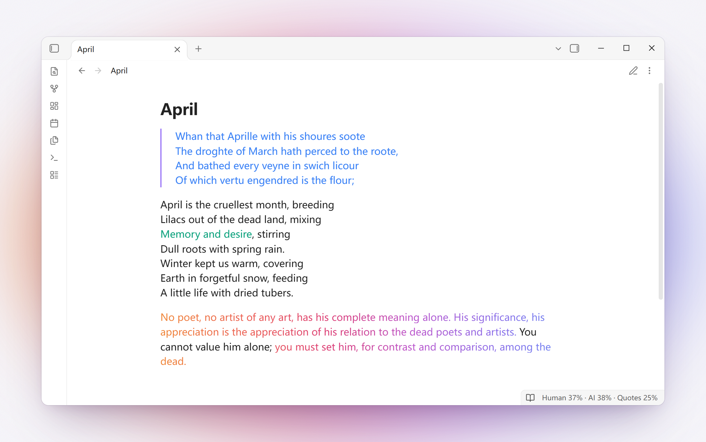
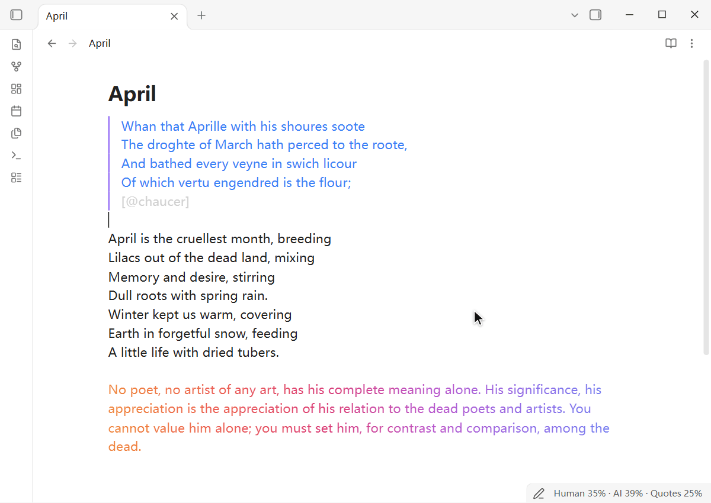

<h1 align="center">Rakkan</h1>

<p align="center">
  <b>Every character, signed.</b><br>
  An Obsidian plugin that shows, in colour, which words of a note you wrote, which an AI wrote, and which you quoted.
</p>

<p align="center">
  <b>English</b> · <a href="README.zh.md">中文</a>
</p>

<picture>
  <source media="(prefers-color-scheme: dark)" srcset="https://raw.githubusercontent.com/Kivisolipse/Rakkan/main/docs/images/screenshot-en-dark.png">
  
</picture>

## Markers

| Write | Meaning |
|---|---|
| Plain text | Written by you |
| `&&text&&` | Written by an AI; `&&text&&[@gpt]` names the model |
| `&& Claude (claude-opus-5-5)` … `&&` | A whole AI block, each marker on a line of its own |
| `@@text@@` | Your own words inside AI text |
| `"text"[@key]`, `「text」[@key]` | A quote, credited to an author (a model's quote stays the model's until checked) |

Without the plugin, the note still reads as ordinary Markdown. The full syntax is in [docs/SPEC.md](docs/SPEC.md).

Select text, right-click and choose **Rakkan → Mark as AI-generated**. What you type inside AI text is marked as yours. Reading view shows only the colours.

<picture>
  <source media="(prefers-color-scheme: dark)" srcset="https://raw.githubusercontent.com/Kivisolipse/Rakkan/main/docs/images/demo-en-dark.gif">
  
</picture>

## Features

- **Colour by model.** Each model family has its own colour. Any family or model can use gradient, rainbow (as in iA Writer) or underline instead.
- **Live preview and reading view.** Markers hide when the cursor leaves the line; reading view shows only the colours.
- **Status bar.** `Human 37% · AI 38% · Quotes 25%`; hover for the count by model and by author.
- **Signing as you write.** Text you type inside AI text is wrapped in `@@…@@`. Moved lines keep their authors. Copied text leaves the markers behind.
- **Paste revision.** Paste an AI's revision of your text; only the changed words are credited to the model.
- **Author book.** One note lists every author: `- @key: Name (id) · human / AI / source · #colour`. Quotes take their author's colour.
- **Search that ignores markers,** in Obsidian's search, the find bar and Omnisearch.
- **Export** to PDF in colour or plain text, to a note without markers, to Pandoc, to Obsidian Publish, and to and from iA Writer's Markdown Annotations.
- **Web Clipper templates**: pages clipped with Obsidian Web Clipper are saved as signed quotes, with an optional AI summary signed by the model that wrote it.
- **English and Chinese** interface.

A detailed guide is in [docs/GUIDE.md](docs/GUIDE.md).

## For AI agents

Rakkan comes with an [Agent Skill](skills/rakkan/SKILL.md) that teaches an agent to sign what it writes: paragraphs in an AI block signed with its model ID, a few words inline, and the author's own markers left as they are.

```bash
npx skills add Kivisolipse/Rakkan
```

Or copy `skills/rakkan` into your agent's skills folder (`~/.claude/skills/` for Claude Code). For an agent without skills, paste the body of [SKILL.md](skills/rakkan/SKILL.md) into its instructions, such as `AGENTS.md` or `CLAUDE.md`.

The skill brings a small command that the agent runs itself, with Node.js 18 or later. `rakkan sign` marks exactly the characters the agent changed in your text, with the same diff as **Paste revision**. `rakkan lint` checks a note for markers that don't work: blocks left open, markers without a partner, `[@key]` that nothing defines. Without the skill, `npx rakkan lint path/to/notes` runs it too.

What the agent writes looks like this:

```
&& Claude (claude-opus-5-5)

Paragraphs the agent wrote.

&&

A sentence of yours, with &&a few words the agent changed&&[@claude-opus-5-5].
```

## Install

Requires Obsidian 1.8.7 or later, on desktop or mobile.

Rakkan is in Obsidian's [community plugins](https://community.obsidian.md/plugins/rakkan). In **Settings → Community plugins**, select **Browse**, search for "Rakkan", then select **Install** and **Enable**.

**By hand.** Download `main.js`, `manifest.json` and `styles.css` from the [latest release](https://github.com/Kivisolipse/Rakkan/releases/latest), put them in `<vault>/.obsidian/plugins/rakkan/`, and enable Rakkan in **Settings → Community plugins**.

## Privacy

Rakkan makes no network requests and collects no data.

- **Clipboard.** Rakkan reads the clipboard only when you run **Paste as AI-generated**, **Paste as quote** or **Paste revision**. When you copy, it puts the text on the clipboard without markers.
- **Vault.** It lists the notes in your vault only to search them while ignoring markers.
- **PDF.** On desktop, **Export as PDF** prints through Electron, as Obsidian's own Export to PDF does. It saves the file where you choose in the save dialog, which may be outside your vault.

## Development

```bash
npm install
npm test
npm run build   # writes main.js
npm run demo    # builds and installs into demo-vault/
npm run fuzz    # the property-based tests at full length
```

Besides the unit tests, a property-based fuzz suite checks the parser, signing, quoting and Clarify quote against random text built from Rakkan's and Markdown's syntax: 16 properties, each run 100 000 times before a release.

## License

[MIT](LICENSE). Inspired by iA Writer's Authorship. Bundles [monkey-around](https://github.com/pjeby/monkey-around) by PJ Eby (ISC).
