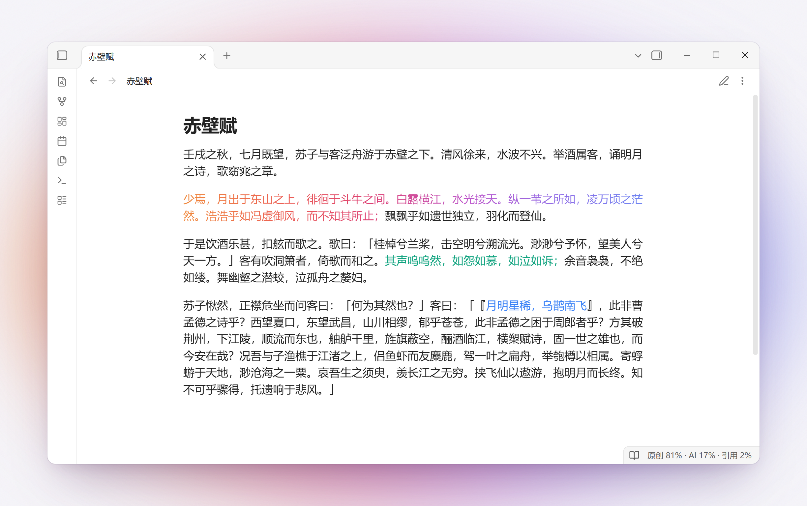
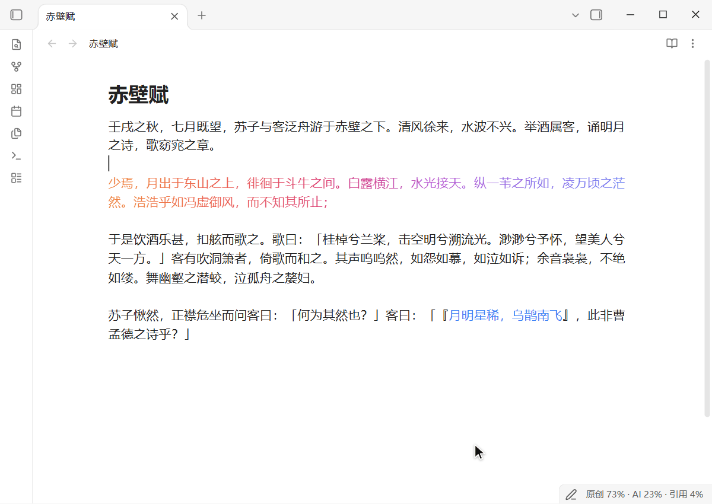

<h1 align="center">Rakkan 落款</h1>

<p align="center">
  <b>每个字都有落款。</b><br>
  一个 Obsidian 插件，用颜色标出笔记里哪些字是你写的、哪些是 AI 写的、哪些是引用的。
</p>

<p align="center">
  <a href="README.md">English</a> · <b>中文</b>
</p>

<picture>
  <source media="(prefers-color-scheme: dark)" srcset="docs/images/screenshot-zh-dark.png">
  
</picture>

## 标记

| 写法 | 含义 |
|---|---|
| 不加标记 | 你写的 |
| `&&文字&&` | AI 写的；`&&文字&&[@gpt]` 注明模型 |
| `&& Claude (claude-opus-5-5)` … `&&` | 整段 AI，开头和结尾各占一行 |
| `@@文字@@` | AI 文字中你自己写的部分 |
| `「文字」[@key]`、`"文字"[@key]` | 引用，归于署名簿中的作者 |

不装插件，笔记仍是普通的 Markdown。完整语法见 [docs/SPEC.zh.md](docs/SPEC.zh.md)。

选中文字，右键选 **Rakkan → 标记为 AI 生成**；在 AI 文字里打的字自动记为你写的；阅读视图只留颜色。

<picture>
  <source media="(prefers-color-scheme: dark)" srcset="docs/images/demo-zh-dark.gif">
  
</picture>

## 功能

- **按模型着色**：每个模型家族有各自的颜色，任一家族或模型都可改用渐变、彩虹字（同 iA Writer）或下划线。
- **实时预览与阅读视图**：光标离开后隐藏标记；阅读视图只显示颜色。
- **状态栏**：`原创 81% · AI 17% · 引用 2%`，悬停可查看各模型、各作者的字数。
- **边写边署名**：在 AI 文字中输入的内容自动包进 `@@…@@`；移动的行保留原有署名；复制到别处时不带标记。
- **粘贴修改**：粘贴 AI 修改后的版本，只有改动的词记在模型名下。
- **署名簿**：用一篇笔记列出所有作者，`- @key: 名字 (标识) · 人 / AI / 来源 · #颜色`；引用显示作者的颜色。
- **忽略格式搜索**：在 Obsidian 的搜索栏、查找栏和 Omnisearch 中都能搜到被标记隔开的词。
- **导出**：带颜色或纯文字的 PDF、去掉标记的笔记、Pandoc、Obsidian Publish，以及与 iA Writer 标注格式互转。
- **中文与英文界面**。

各项功能的详细说明见 [docs/GUIDE.zh.md](docs/GUIDE.zh.md)。

## 给 AI agent

Rakkan 附带一个 [Agent Skill](skills/rakkan/SKILL.md)，教 agent 给自己写的字署名：整段放进 AI 块并署上模型 ID，零星几个字用行内标记，作者原有的标记一律保留。

```bash
npx skills add Kivisolipse/Rakkan
```

也可以把 `skills/rakkan` 整个文件夹复制到 agent 的 skills 目录（Claude Code 是 `~/.claude/skills/`）。不支持 skill 的 agent，把 [SKILL.md](skills/rakkan/SKILL.md) 的正文贴进它的指令文件，比如 `AGENTS.md` 或 `CLAUDE.md`。Skill 用英文写成，对中文笔记同样适用。

Skill 附带一个小命令，由 agent 自己运行，需要 Node.js 18 或更高版本。`rakkan sign` 只把 agent 在你文字里改动的字标出来，精确到字，用的是和「粘贴修改」同一套比对；`rakkan lint` 检查笔记里不起作用的标记：没闭合的块、没配对的标记、没有定义的 `[@key]`。

agent 写出来是这样的：

```
&& Claude (claude-opus-5-5)

agent 写的段落。

&&

你写的一句话，其中&&agent 改的几个字&&[@claude-opus-5-5]。
```

## 安装

需要 Obsidian 1.8.7 或更高版本，支持桌面端和移动端。上架社区插件之前，可用以下两种方式安装。

**用 BRAT 安装（推荐）**。有新版本时，BRAT 也会自动更新 Rakkan。

1. 在「设置 → 第三方插件」中安装并启用 [BRAT](https://github.com/TfTHacker/obsidian42-brat)。
2. 在命令面板中运行 **BRAT: Add a beta plugin for testing**。
3. 填入 `Kivisolipse/Rakkan`，选择最新版本，点 **Add plugin**。

**手动安装**。从[最新版本](../../releases/latest)下载 `main.js`、`manifest.json`、`styles.css`，放入 `<库>/.obsidian/plugins/rakkan/`，然后在「设置 → 第三方插件」中启用 Rakkan。

## 隐私

Rakkan 不发出任何网络请求，也不收集任何数据。

- **剪贴板**：只在你运行「粘贴为 AI 生成」「粘贴为引用」「粘贴修改」时读取剪贴板；复制时，放进剪贴板的是去掉标记的文字。
- **库**：列出库里的笔记，只用于忽略标记的搜索。
- **PDF**：在桌面端，「导出为 PDF」与 Obsidian 自带的导出 PDF 一样通过 Electron 打印，文件保存到你在保存对话框中选择的位置，可能位于库外。

## 开发

```bash
npm install
npm test
npm run build   # 生成 main.js
npm run demo    # 构建并安装到 demo-vault/
```

## 许可

[MIT](LICENSE)。灵感来自 iA Writer 的 Authorship。打包了 PJ Eby 的 [monkey-around](https://github.com/pjeby/monkey-around)（ISC 许可）。
